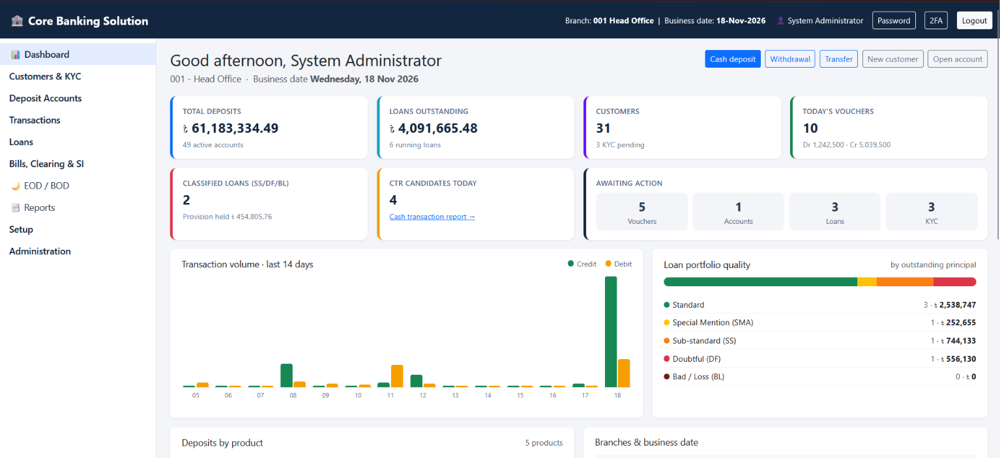
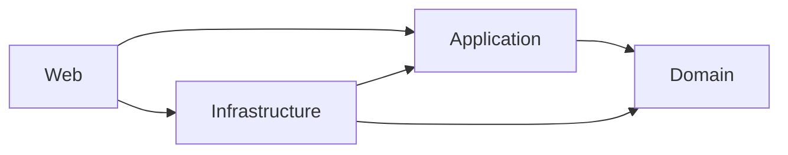

# Core Banking Solution (CBS)

[](https://dotnet.microsoft.com/)
[](https://learn.microsoft.com/aspnet/core/mvc/)
[](https://learn.microsoft.com/ef/core/)
[](https://www.microsoft.com/sql-server)
[](#architecture)
[](#regulatory-alignment)

A web-based **core banking system** built with ASP.NET Core 9 MVC, Entity Framework Core, SQL Server and ASP.NET Identity. It implements double-entry accounting, deposits, loans, remittances, clearing, end-of-day processing, sanction screening and regulatory reporting, aligned with the Bangladesh Bank guideline **"Guidelines on Core Banking Solution (CBS) Features and Controls", Version 2.0 (BRPD Circular No. 12, 13 May 2024)** - see [bb bank software.pdf](bb%20bank%20software.pdf).



## Table of contents

- [Features](#features)
- [Screenshots](#screenshots)
- [Architecture](#architecture)
- [Tech stack](#tech-stack)
- [Getting started](#getting-started)
- [Configuration](#configuration)
- [Testing](#testing)
- [Regulatory alignment](#regulatory-alignment)
- [Key controls](#key-controls)
- [Learning: how banks create money out of thin air](#learning-how-banks-create-money-out-of-thin-air)
- [Roadmap and scope](#roadmap-and-scope)

## Features

| Area | Highlights |
|---|---|
| **Customers & KYC** | CIF with check digit, 20+ customer categories, photo/signature/NID upload, maker-checker KYC, risk rating, PEP flag |
| **Deposit accounts** | Savings, Current (overdraft), SND, FDR, DPS, joint accounts, nominees, power of attorney |
| **Transactions** | Cash deposit/withdrawal, same-branch and inter-branch transfer, limits, lien, cheque books, stop payment |
| **General ledger** | Tree chart of accounts, double-entry vouchers, self-balancing check, reversal, back-value entries |
| **Loans** | Term (EMI) and demand loans, approval -> disbursement -> repayment, schedules, SMA/SS/DF/BL classification, provisioning |
| **Bills & remittance** | Payment order, demand draft, TT with commission and VAT |
| **Clearing** | Inward/outward registers, settlement vouchers, cheque returns and dishonour charges |
| **EOD / BOD** | Branch-wise end-of-day in one transaction: interest accrual, classification, maturity, excise duty, year-end close |
| **Compliance** | UNSCR and local sanction screening, CTR candidates, full audit trail |
| **Administration** | Users, roles, password policy, 2FA (authenticator app), IP and operating-hour restrictions |
| **Reporting** | Trial balance, balance sheet, income statement, day book, loan portfolio and provision, CTR, statements - printable and CSV-exportable |

## Screenshots

| Dashboard |
|---|
|  |

> More screenshots can be added under [docs/screenshots](docs/screenshots) and referenced in this table.

## Architecture

Clean Architecture, feature-first inside every layer. Dependencies point inwards only.

```
src/
  CoreBanking.Domain           entities, enums, BankingException, Money, Roles          (no dependencies)
  CoreBanking.Application      use cases per feature, abstractions (IApplicationDbContext,
                               ICurrentUser, INumberSequence, IFileStore, IUserAdministration)
  CoreBanking.Infrastructure   EF Core DbContext + migrations + seeding, Identity-backed
                               user administration, SQL number sequences, file store
  CoreBanking.Web              MVC controllers (Features/<Feature>), views, middleware, composition root
tests/
  CoreBanking.Tests            unit, service-integration (real SQL Server LocalDB) and web tests
```



- `Web` never touches EF directly; controllers call Application services (`AccountQueries`, `CustomerService`, `SetupService`, `ReportService`, ...). `Program.cs` is the only place that wires `Infrastructure`.
- Every feature owns its folder in each layer: Accounts, Customers, Ledger, Deposits, Transactions, Remittances, Clearing, Loans, StandingInstructions, Eod, Reports, Setup, Sanctions, Users, Dashboard, Parameters, Numbering, Lookups.

## Tech stack

| Concern | Technology |
|---|---|
| Runtime | .NET 9, ASP.NET Core MVC (Razor) |
| Persistence | Entity Framework Core, SQL Server |
| Identity | ASP.NET Core Identity, roles, TOTP 2FA |
| UI | Bootstrap 5, Razor views |
| Tests | xUnit, SQL Server LocalDB |

## Getting started

### Prerequisites

- [.NET 9 SDK](https://dotnet.microsoft.com/download/dotnet/9.0)
- SQL Server or SQL Server LocalDB

### Run

```bash
git clone <repository-url>
cd CoreBankingSolution
dotnet run --project src/CoreBanking.Web
```

Open `http://localhost:5054` (or `https://localhost:7026`).

On start-up the application applies EF migrations (`Database:Mode` = `Migrate`) and seeds reference data: currencies, branches (001 Head Office, 002 Motijheel), chart of accounts, products, bank parameters, excise slabs and roles. Demo data is seeded too; set `Seed:DemoData=false` to skip it.

### First login

| Field | Value |
|---|---|
| Email | `admin@corebank.local` |
| Password | `Admin@12345` |

You are forced to change the password immediately. Public registration is disabled; administrators create users under **Administration -> Users** (a one-time temporary password is shown).

### Roles

| Role | Purpose |
|---|---|
| Administrator | Full access, user management |
| Manager | Setup, second-level authorization |
| Supervisor | Authorization (checker) |
| Officer | Operations |
| Teller | Cash and counter transactions |

## Configuration

| Setting | Location | Description |
|---|---|---|
| `ConnectionStrings:DefaultConnection` | `src/CoreBanking.Web/appsettings.json` | SQL Server connection string |
| `Database:Mode` | `appsettings.json` | `Migrate` applies migrations on start-up |
| `Seed:DemoData` | `appsettings.json` | `false` skips demo data |

Do not commit real credentials. Use [user secrets](https://learn.microsoft.com/aspnet/core/security/app-secrets) locally and environment variables in deployment:

```bash
dotnet user-secrets set "ConnectionStrings:DefaultConnection" "Server=(localdb)\MSSQLLocalDB;Database=CoreBanking;Trusted_Connection=True;" --project src/CoreBanking.Web
```

Bank-level behaviour (GL codes, rates, tax/VAT, thresholds) is configured under **Setup -> Bank parameters**.

## Testing

```bash
dotnet test
```

The suite needs SQL Server **LocalDB** (`(localdb)\MSSQLLocalDB`). Every run creates its own throw-away databases, applies the real migrations, and drops them afterwards; it never touches the configured application database.

- `Unit/` - money rounding, check digits, loan schedule and classification, allocation, parameter rules, access policy.
- `Services/` - ledger, deposits, remittances, clearing, loans, EOD/year-end, numbering, sanctions, rates, audit, reports, setup.
- `Web/` - every page renders with demo data, role/permission matrix, anti-forgery, forced password change, end-to-end maker -> checker flows.

## Regulatory alignment

| BB guideline section | Implemented |
|---|---|
| 1.1 Bank & branch setup | Branch hierarchy (HO > Division > Region > Cluster > Branch > Sub-branch > Booth), cost/profit centres, routing number, 13-digit account numbers with Luhn check digit (branch 3 + product 2 + serial 7 + check 1), configurable products and fee schedule, maker-checker approved back-dated interest-rate slabs, holiday calendar |
| 1.2 EOD/BOD, month-end, year-end | Branch-wise EOD with step log; blocks on unauthorized vouchers; standing instructions, interest accrual, loan interest recognition, classification and provisioning, FDR/DPS maturity and auto-renewal, source tax, dormancy flagging, excise duty, P&L -> retained earnings transfer |
| 1.3 General ledger | Double-entry vouchers, self-balancing check, inter-branch GL, back-value entries, reversal vouchers, maker-checker, two authorization levels, no edit after authorization |
| 1.4 Reconciliation | Inter-branch reconciliation report (nets to zero), clearing/settlement GL |
| 1.5 Clearing | Inward/outward register, settlement vouchers, returns and dishonour charge |
| 1.6-1.8 Accounts, teller, SI | Deposits, withdrawals, transfers, limits, lien, cheque books, stop payment, standing instructions |
| 2 Bills & remittance | Payment order, demand draft, TT: issue, pay, cancel, stop, commission + VAT |
| 3 Deposits | Savings, Current, SND, FDR, DPS, joint accounts, nominees, power of attorney, KYC |
| 4 Loans | Term and demand loans, schedules, installment allocation, overdue days, classification, provisioning |
| 8 CRM | Customer master, document upload, KYC verification, risk rating, PEP flag |
| 9 / UNSCR | Sanction screening on customers, joint holders, nominees, PoA, introducer, beneficiaries, loans, remittance |
| 10 System administration | Users, roles, password policy (8+ chars, history of 4, 30-day expiry, lockout), 2FA, audit trail |
| 11 Reporting | Trial balance, GL statement, day book, balance sheet, income statement, portfolio, dormant, maturity, CTR, registers, audit trail |

## Key controls

- **Maker-checker**: the creator of a voucher, KYC, loan or rate can never approve it; amounts at or above `Level2Amount` and back-valued entries need Manager-level approval.
- **Audit trail**: every insert, update and delete is logged (user, IP, before -> after values).
- **Day close**: blocked while unauthorized vouchers, unapproved accounts or unsettled clearing items remain.
- **Concurrency**: voucher authorization and remittance payment are protected against double processing.

## Learning: how banks create money out of thin air

This section is for anyone learning how banking works. It uses the same double-entry rules this project implements.

### The short answer

Most money in a modern economy is not printed cash. It is **bank deposits**: numbers in a bank's ledger. When a bank makes a loan, it does not hand over money that someone else deposited. It **creates a new deposit** in the borrower's account and, at the same moment, records a **loan asset** for itself. Both sides of the books grow together, so the bank's accounting still balances, yet the total money supply has increased.

### Step by step

Alice borrows 1,000 from a bank.

**Before the loan**

| Assets | Liabilities |
|---|---|
| Cash / reserves: 100 | Customer deposits: 100 |

**At loan disbursement** (a single balanced voucher)

| Account | Debit | Credit |
|---|---|---|
| Loans to customers (asset) | 1,000 | |
| Alice's deposit account (liability) | | 1,000 |

**After the loan**

| Assets | Liabilities |
|---|---|
| Cash / reserves: 100 | Customer deposits: 1,100 |
| Loans to customers: 1,000 | |
| **Total: 1,100** | **Total: 1,100** |

No existing customer lost a taka. Alice now holds 1,000 of spendable money that did not exist a moment ago. The bank "created it" with a ledger entry, because a deposit is simply the bank's promise to pay.

### Where it appears in this codebase

Loan disbursement in [LoanService.cs](src/CoreBanking.Application/Features/Loans/LoanService.cs) posts exactly this shape of voucher:

```csharp
req.Dr(l.Product.GlAccountId, null, l.Principal, "Loan principal", ...);        // asset grows
req.Cr(null, l.SettlementAccountId, l.Principal - fee - vat, "Loan proceeds");  // deposit is created
```

The debit side is the loan asset. The credit side is the borrower's deposit liability (net of fee and VAT). The ledger refuses unbalanced vouchers, so the books always balance while deposits grow. You can see the result in the **Total deposits** and **Loans outstanding** cards on the dashboard.

### Why it is not unlimited

| Constraint | What it does |
|---|---|
| **Repayment** | When Alice repays, the deposit and the loan are both destroyed. Money is created by lending and destroyed by repayment. |
| **Capital requirements** | Regulators require equity against risk-weighted assets (Basel III). Bad loans are absorbed by capital, so a bank cannot lend without limit. |
| **Reserve and liquidity rules** | Banks must hold reserves (CRR) and liquid assets (SLR) and settle payments with the central bank. If Alice pays someone at another bank, her bank must transfer real reserves to that bank. |
| **Profitability and credit risk** | Loans that default are written off against profit and capital. Provisioning (SMA, SS, DF, BL in this project) models this. |
| **Central bank policy** | Policy rates and regulation set the cost and the pace of lending. |

### Common misconceptions

- **"Banks lend out other people's deposits."** Deposits are the result of lending, not only its source. A single bank still needs reserves and funding to settle payments, so it cannot ignore deposits.
- **"Banks can create unlimited money."** Capital, liquidity, regulation and credit risk bind them.
- **"It is a trick or fraud."** It is legal, standard accounting. Central banks such as the Bank of England have published explanations of it.

### Further reading

- Bank of England, *Money creation in the modern economy* (Quarterly Bulletin 2014 Q1)
- Bank of England, *Money in the modern economy: an introduction*
- Bangladesh Bank, CRR and SLR requirements

## Roadmap and scope

**Out of scope for now:** Trade Service (LC, export/import, section 5), Treasury front/middle/back office (section 6), alternative delivery channels such as ISO 8583, ATM and POS (section 7), multi-currency revaluation, Islamic-bank profit-sharing calculation. Multi-currency exists only as master data (currencies and spot rates).

## License

No license has been specified. All rights reserved by the repository owner until one is added.
